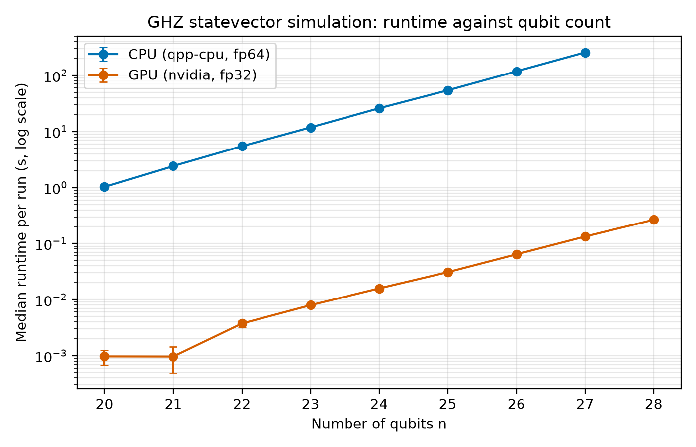
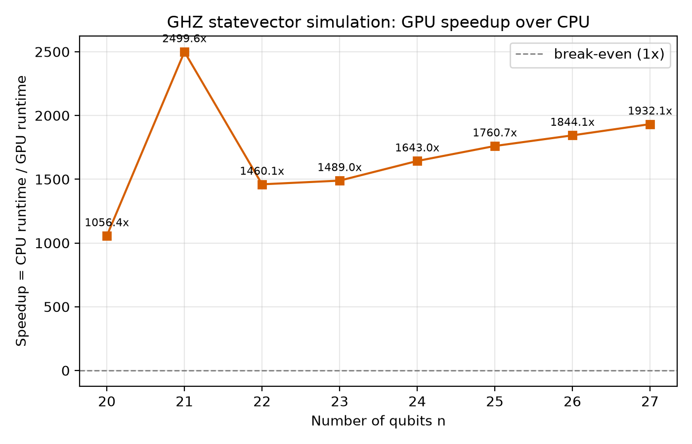
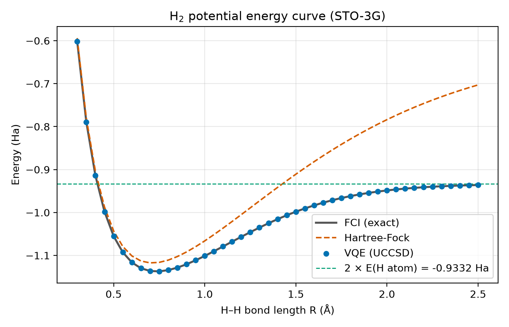
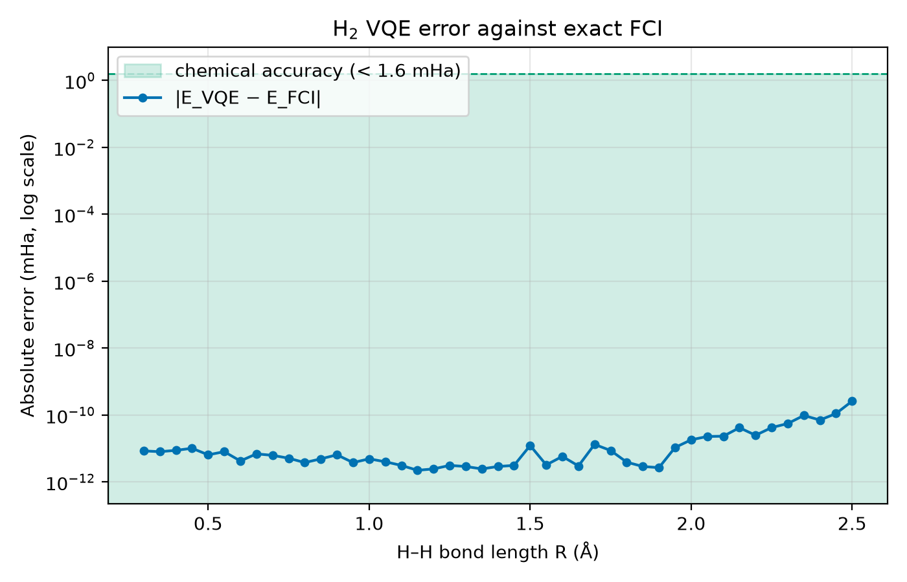
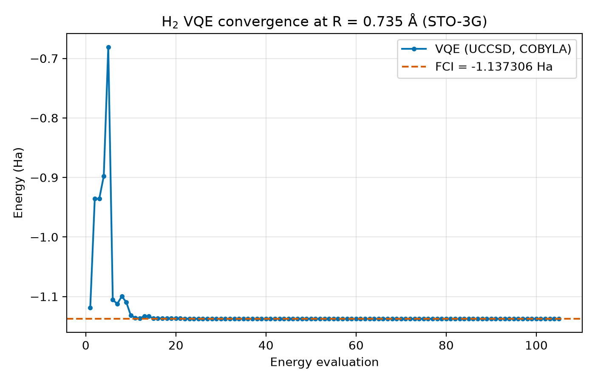

<div align="center">

# gpu-quantum-sim

    

**Two measured experiments on one laptop: how much faster a GPU simulates a GHZ circuit than a CPU (n = 20 to 28 qubits), and a noiseless H2 VQE that matches the exact energy at every bond length from 0.30 to 2.50 angstrom.**

[Results](#results) · [Real vs simulated](#what-is-real-and-what-is-simulated) · [Quick start](#quick-start) · [Structure](#project-structure) · [Limitations](#honest-limitations) · [Troubleshooting](#troubleshooting) · [Problem statement](docs/problem_statement.md)

<sub>Built by <b>Sarvagya Sharma</b>. All numbers in this file come from the files in <code>results/</code>.</sub>

</div>

---

## The problem

A quantum computer with n qubits has a state of 2^n complex numbers. A classical simulator stores all of them, so memory doubles with each added qubit.

| Qubits (n) | State vector, fp64 (16 bytes each) | State vector, fp32 (8 bytes each) |
|-----------:|-----------------------------------:|----------------------------------:|
| 20 | 16 MiB | 8 MiB |
| 26 | 1 GiB | 512 MiB |
| 27 | 2 GiB | 1 GiB |
| 28 | 4 GiB | 2 GiB |
| 30 | 16 GiB | 8 GiB |

This repository measures where one laptop stops, and how much a GPU helps, with [NVIDIA CUDA-Q](https://github.com/NVIDIA/cuda-quantum) 0.13.0.

Test machine: RTX 4050 Laptop GPU (6.0 GiB VRAM, driver 566.07), 4 CPU threads, 7.8 GiB RAM, WSL2 (Ubuntu 24.04), Python 3.12.3. The details are in `results/hardware.json`.

---

## Results

### Experiment 1: GHZ benchmark (CPU against GPU)

A GHZ circuit puts n qubits in the state (|00...0> + |11...1>) / sqrt(2). Each point is the median of 5 timed runs (1 untimed warm-up, 100 shots per run). The `qpp-cpu` target simulates in fp64. The `nvidia` target simulates in fp32.

| n | CPU median (s) | CPU std (s) | GPU median (s) | GPU std (s) | CPU / GPU |
|--:|---------------:|------------:|---------------:|------------:|----------:|
| 20 | 1.0279 | 0.0146 | 0.0010 | 0.0003 | 1,056 |
| 21 | 2.4196 | 0.0435 | 0.0010 | 0.0005 | 2,500 |
| 22 | 5.4682 | 0.0883 | 0.0037 | 0.0005 | 1,460 |
| 23 | 11.8392 | 0.1734 | 0.0080 | 0.0005 | 1,489 |
| 24 | 26.0354 | 0.2627 | 0.0158 | 0.0007 | 1,643 |
| 25 | 54.3897 | 0.5528 | 0.0309 | 0.0005 | 1,761 |
| 26 | 118.5332 | 1.7719 | 0.0643 | 0.0006 | 1,844 |
| 27 | 258.0869 | 3.1155 | 0.1336 | 0.0004 | 1,932 |
| 28 | not measured (skipped) | | 0.2660 | 0.0009 | |

All rows come from one run of `make all` (log: `results/make_all.log`).




How to read this:

- Each added qubit multiplies the run time by 2.09 to 2.35 on the CPU (n = 20 to 27) and by 1.95 to 2.12 on the GPU (n = 23 to 28). On the GPU the step from n = 21 to n = 22 is 3.87 times, because the time at n = 20 and n = 21 is flat (about 1 ms). The GPU is 1,489 to 1,932 times faster from n = 23 to n = 27, and the ratio rises with n.
- The ratio at n = 20 and n = 21 is dominated by the fixed cost of a GPU call (about 1 ms), so it is not a clean measure of the compute speed.
- The CPU stops at n = 27. The sweep skipped n = 28 because the estimated peak memory (10.55 GiB) is more than the free RAM. See [Honest limitations](#honest-limitations).
- The GPU reaches n = 28 (2 GiB state vector) in 0.2660 s. The sweep default stops at n = 28 because of the CPU limit. I did not run the GPU at n = 29, which needs 4 GiB.
- The comparison is not like for like: the GPU uses fp32 and the CPU uses fp64.

The data is in `results/ghz_benchmark.csv` (columns: `target, n, median_s, std_s, est_mem_gb, runs, shots`).

### Experiment 2: H2 molecule VQE

The Hamiltonian is H2 in the STO-3G basis with the Jordan-Wigner mapping: 4 qubits and 15 Pauli terms (identity included). The ansatz is a Hartree-Fock reference state followed by UCCSD. The optimizer is COBYLA (tolerance 1e-9, at most 1000 evaluations per point). Each bond length starts from the optimum of the previous one. The reference is the exact (FCI) energy.

| Quantity | Value |
|----------|------:|
| Bond lengths | 45 points, R = 0.30 to 2.50 A, step 0.05 A |
| Largest error against FCI | 2.6e-10 mHa (at R = 2.50 A) |
| Error at R = 0.735 A | 5.1e-12 mHa |
| Chemical accuracy limit | 1.6 mHa |
| VQE equilibrium (minimum of the VQE curve) | R = 0.7349 A, E = -1.1373060512 Ha |
| FCI energy at R = 0.735 A | -1.1373060358 Ha |
| Evaluations from a cold start at R = 0.735 A | 105 |




The error plot has a log axis. It shows the real errors (about 2e-12 to 2.6e-10 mHa). It rises after R = 1.9 A. The chemical accuracy band (1.6 mHa) is far above the data.


The VQE minimum is 1.55e-8 Ha lower than the FCI value in the table because the two values are at different bond lengths (0.7349 A and 0.735 A). It is not an error.

The error grows with the bond length. Points at long bond lengths need more evaluations (991 at R = 2.45 A, 997 at R = 2.50 A, both below the 1000 limit).

SciPy reports success for all 45 points and for the cold start (`n_not_converged` = 0 in `results/h2_summary.json`, column `converged` in `results/h2_pes.csv`). The results are the same as in the first run.

The data is in `results/h2_pes.csv` and `results/h2_summary.json`.

**The `nvidia` (fp32) target.** I ran one VQE at R = 0.735 A with different COBYLA tolerances (`--tol`). The table shows one run for each row. I did not repeat the runs.

| Target | `--tol` | Evaluations | SciPy success | Error against FCI (mHa) |
|--------|--------:|------------:|--------------:|------------------------:|
| `qpp-cpu` (fp64) | 1e-9 | 105 | yes | 5.1e-12 |
| `qpp-cpu` (fp64) | 1e-6 | 81 | yes | 1.9e-10 |
| `qpp-cpu` (fp64) | 1e-4 | 50 | yes | 4.2e-07 |
| `nvidia` (fp32) | 1e-9 | 137 | yes | 2.7e-03 |
| `nvidia` (fp32) | 1e-6 | 61 | yes | 2.7e-03 |
| `nvidia` (fp32) | 1e-4 | 47 | yes | 2.8e-03 |

With fp32 the error stays at about 2.7e-3 mHa for every tolerance. This is the precision limit of fp32. It is about 600 times below the 1.6 mHa chemical accuracy limit. A tolerance below 1e-6 gives no better result with fp32, and it costs more evaluations (137 against 61). The VQE results in this README use the `qpp-cpu` target with the default tolerance 1e-9. I did not run the full 45-point sweep on the `nvidia` target.

---

## What is real and what is simulated

| Item | Status |
|------|--------|
| GHZ timings (`qpp-cpu` n = 20 to 27, `nvidia` n = 20 to 28) | Measured on the test machine in one run of `make all` from a new virtual environment (log: `results/make_all.log`). The `qpp-cpu` n = 28 point was skipped by the memory rule, not run. |
| Earlier GHZ runs | A first run was stopped by a WSL restart after `qpp-cpu` n = 27. Its numbers are not in the tables. They are used in [limitation 3](#honest-limitations) to show the run-to-run difference. |
| GHZ correctness | Checked before each run: at n = 8 with 4000 shots, only all-0 and all-1 appear, each near 50% (tolerance 5%). Both targets pass. |
| H2 VQE | Real optimizer, but a **noiseless** simulation with exact expectation values. It does not show how VQE behaves on real hardware with noise and a finite number of shots. |
| Real quantum hardware | Not used. |
| Other GPUs, other machines | Not measured. |

---

## Quick start

The project runs on Linux, WSL2 or Colab. The pinned versions are in `requirements.txt`.

```bash
git clone https://github.com/BUTTERFINGERS7498/GPU-QUANTUM-SIMULATOR.git
cd GPU-QUANTUM-SIMULATOR

make quick     # reduced run of both experiments (CPU only, a few minutes)
make test      # 164 tests with coverage
make all       # install, test, full GHZ benchmark, full H2 VQE, plots
```

Run one part:

```bash
python -m src.ghz_benchmark --quick                  # n = 10..18, 3 runs, writes to results/quick
python -m src.ghz_benchmark                          # n = 20..28, 5 runs
python -m src.ghz_benchmark --only nvidia            # one target
python -m src.ghz_benchmark --resume                 # keep CSV rows, measure the missing points
python -m src.ghz_benchmark --resume --retry-failed  # also try again the sizes that failed before
python -m src.ghz_benchmark --plot-only              # redraw plots from the CSV
python -m src.h2_vqe                                 # full H2 sweep
python -m src.h2_vqe --quick                         # R = 0.50..1.50 step 0.25
python -m src.h2_vqe --tol 1e-6                      # COBYLA final step size (default 1e-9)
```

Notes:

- The full GHZ sweep takes a long time on the CPU. At n = 27 one point alone takes about 26 minutes (6 runs at about 258 s). The whole `make all` (install, tests, GHZ, H2, plots) took about 56 minutes on the test machine (start and end times in `results/make_all.log`). I did not time the GHZ part alone.
- Without an NVIDIA GPU the benchmark measures the CPU only, and it logs that the GPU part is skipped.
- A sweep writes one row to the CSV after each point. A stop loses at most one point. A damaged last row is skipped with a warning, and `--resume` measures that point again.
- A run without `--resume` replaces only the rows of the targets that run. `--only nvidia` keeps the CPU rows. A run that has no target to measure exits with code 1 and leaves the CSV unchanged.
- Each point runs in its own subprocess. A crash at one size does not lose the earlier rows. After the first failure the sweep skips the larger sizes of that target.
- A failed size is written to `results/ghz_failures.csv`. A later `--resume` does not try it again (a timeout can cost up to 3600 s). Use `--retry-failed` to try it again. A run without `--resume` clears the failures of the targets that run.
- Each CSV row stores the `runs` and `shots` of its measurement. A `--resume` with other values logs a warning, because rows with different settings stay in one file. The `results/ghz_benchmark.csv` in this repository was written before these columns existed, so its rows have no `runs` and `shots` values. All of its rows used the defaults (5 runs, 100 shots). I took this from the commands that I ran, not from the file.
- A size is skipped when its estimated peak memory does not fit in 90% of the free memory. For `qpp-cpu` the peak is estimated as 2.5 x the state vector plus 0.55 GiB. I measured this on the test machine at n = 4, 22, 24 and 25 (peak RSS of one worker); larger n is an extrapolation. For `nvidia` the estimate is the plain state vector, and I did not measure the GPU peak.
- Colab: `notebooks/colab_quickstart.ipynb`. `REPO_URL` in its third cell points to this repository. While the repository is private, a clone in Colab needs a token in the URL (`https://<token>@github.com/...`). If you make the repository public, no token is needed. I did not run the notebook in Colab.

---

## Project structure

```text
src/
  hardware.py         detect CPU, RAM and NVIDIA GPU; estimate state-vector memory
  ghz_benchmark.py    GHZ sweep: worker subprocesses, incremental CSV, --resume, --only
  ghz_plots.py        runtime and speedup plots
  h2_vqe.py           H2 Hamiltonian, UCCSD ansatz, COBYLA, bond-length sweep
  h2_plots.py         PES, error and convergence plots
tests/                164 tests (pytest); coverage 96%
results/              CSV, JSON, PNG and run logs from the runs above
docs/problem_statement.md   hackathon problem statement based on this project
notebooks/colab_quickstart.ipynb
scripts/run_ghz.sh    helper to run the GHZ sweep in WSL: bash scripts/run_ghz.sh <log-name> [flags]
Makefile, requirements.txt, pytest.ini
```

Test coverage by file: `hardware.py` 100%, `ghz_plots.py` 100%, `h2_plots.py` 100%, `h2_vqe.py` 95%, `ghz_benchmark.py` 92% (the `--plot-only` path and a few error branches are not covered). The worker tests replace `subprocess.run`, so no test starts a real worker process for the sweep.

---

## Honest limitations

1. **The CPU result stops at n = 27.** The n = 28 CPU run needs a 4 GiB state vector. In an earlier run that I did not repeat, the n = 28 worker used about 7.2 GB of the 7.9 GB of WSL RAM and the run ended with no result and no error line. I did not prove the cause (for example the out-of-memory killer). A later measurement shows that a worker peaks at about 2.5 x the state vector plus 0.55 GiB (measured at n = 4, 22, 24 and 25 only). That extrapolates to about 10.6 GiB at n = 28, more than the 7.8 GiB of RAM. In the `make all` run the sweep logged `SKIP qpp-cpu n=28 ... estimated peak 10.55 GiB`. So the n = 28 skip rests on the extrapolation: I did not run n = 28 again to confirm it.
2. **The speedup is not like for like.** The GPU uses fp32. The CPU uses fp64.
3. **Run-to-run variation is known from two runs only.** The tables use the `make all` run. An earlier run on the same machine (stopped after `qpp-cpu` n = 27) gave CPU medians that differ from the `make all` run by -4.4% to +1.0% for n = 22 to 27, and by about +10% at n = 20 and n = 21. Its GPU medians are 6.1% to 14.6% higher for n = 22 to 28 (22.8% and 30.1% higher at n = 20 and n = 21). I took the earlier numbers from its log. I have no repeat statistics beyond these two runs, so the std columns show the spread inside one run, not between runs.
4. **Small sizes.** At n = 20 and n = 21 the GPU time is about 1 ms and the ratio is dominated by the fixed cost of a call.
5. **The VQE is noiseless.** The near-zero error shows that the ansatz and the optimizer work for H2 in this basis. It says nothing about noise.
6. **One molecule, one basis.** H2 in STO-3G is a 4-qubit problem. It does not test the memory limit.
7. **One machine.** All numbers come from one RTX 4050 laptop under WSL2.
8. **CUDA-Q 0.13.0 is pinned.** On this machine the `nvidia` target failed in CUDA-Q 0.16.0 (`[custatevec] invalid wire in measureQubit`, or a segmentation fault, even for 2 qubits). I did not find the root cause.

---

## Troubleshooting

| Problem | Fix |
|---------|-----|
| `nvidia` target fails with a custatevec error or a segmentation fault | Use CUDA-Q 0.13.0 (`requirements.txt`). |
| `cudaq` kernel fails when you run code from stdin or a REPL | Define kernels in a `.py` file. |
| A long run in WSL stops by itself (`uptime` shows 0 min) | The WSL VM restarted. A detached process died when its `wsl.exe` launcher ended. Keep one `wsl` call open for the whole run, and use `--resume` to continue. |
| `wsl -d X -- bash -c '... $var ...'` shows empty variables | The outer shell expands `$var`. Use a script file or literal values. |
| The Windows laptop goes to sleep during a run | On AC power: `powercfg /change standby-timeout-ac 0`. |
| A CPU size is skipped with a `SKIP` line | The estimated peak (2.5 x state vector + 0.55 GiB) does not fit in 90% of the free RAM. Free memory or lower `--max-qubits`. |
| `--plot-only` fails with a file error | Run the experiment first. The plots are built from `results/ghz_benchmark.csv` and `results/h2_pes.csv`. |

---

## Glossary

- **GHZ state**: an entangled state of n qubits, (|00...0> + |11...1>) / sqrt(2).
- **State vector**: the list of 2^n complex amplitudes that describes n qubits.
- **fp32, fp64**: single and double precision (8 and 16 bytes per complex amplitude).
- **VQE**: Variational Quantum Eigensolver. A classical optimizer tunes circuit parameters to minimize the energy.
- **UCCSD**: a chemistry ansatz (unitary coupled cluster with singles and doubles).
- **FCI**: full configuration interaction. The exact energy in the chosen basis.
- **STO-3G**: a minimal basis set for the electrons.
- **mHa**: milli-Hartree. Chemical accuracy is 1.6 mHa.

---

## License

MIT. See `LICENSE`.

## Credits

Built by Sarvagya Sharma. Simulation: [NVIDIA CUDA-Q](https://github.com/NVIDIA/cuda-quantum). Chemistry: [PySCF](https://pyscf.org/) and [OpenFermion](https://github.com/quantumlib/OpenFermion). Optimization: [SciPy](https://scipy.org/).
